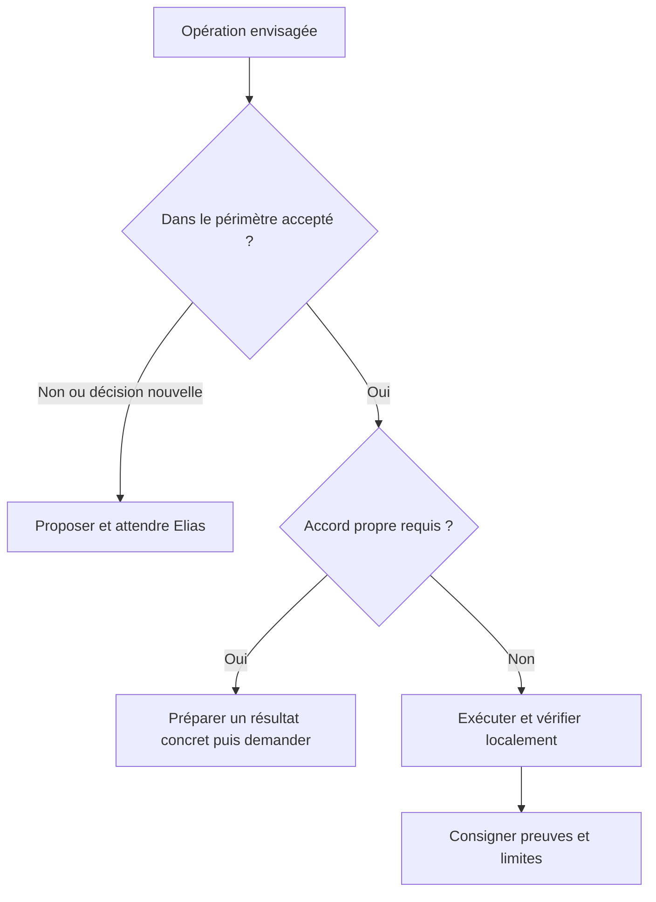

# Autonomie et permissions

État des accords : 5 novembre 2026. Cette politique accompagne la méthode ; elle ne remplace
pas les instructions explicites d’Elias en session ni les permissions techniques de l’environnement.
Une nouvelle autorisation doit préciser l’opération et sa destination. L’acceptation d’une
organisation, d’une spec, d’une issue ou d’une PR n’autorise pas les écritures externes qui suivent.

## Déjà autorisé dans un périmètre accepté

| Opération | Limite |
|---|---|
| Lire les fichiers et sources utiles, comparer des versions | Respecter les secrets et les données privées ; aucune écriture distante |
| Rédiger les documents et plans demandés | Ne pas inventer de validation ou changer une décision produit |
| Modifier et corriger localement les fichiers prévus | Préserver le travail existant ; pas de changement de mouvement ou d’architecture non accepté |
| Exécuter les vérifications locales disponibles | Pas d’installation, de réservation réelle, de notification ni d’appel distant en écriture |
| Préparer un commit et une description de PR en local | Ne pas envoyer, ouvrir la PR, fusionner ou déployer |
| Enregistrer les observations et les leçons dans le chantier | Aucune diffusion automatique sur GitHub, Slack ou email |

Dans le chantier #5, Elias a autorisé les documents, les consignes Portfolio et leurs
vérifications. Notes → Chat est un exemple documentaire. Les mouvements, la relecture au scroll,
les exports, les futures sections et les fichiers du Studio restent hors du travail autorisé.

## Accord explicite encore nécessaire

- Push Git, création ou modification d’une issue, d’une PR, d’un projet GitHub ou d’un commentaire.
- Fusion, déploiement, publication et retour arrière d’un environnement distant.
- Création ou annulation d’un vrai rendez-vous, envoi d’email ou de notification.
- Installation ou ajout d’outil, plugin, dépendance ou skill non déjà demandé.
- Suppression de branches ou de travaux, migration, modification de secrets ou d’accès.
- Choix de positionnement, changement d’architecture, extension du périmètre, changement du rendu
  ou du comportement validé au-delà des adaptations permises par le contrat du composant.

Une permission accordée pour un envoi précis reste valable jusqu’à son exécution ; ne pas la
redemander pendant sa préparation. Elle n’autorise pas un second envoi. Si le résultat d’une
écriture est incertain, vérifier son état avant toute nouvelle tentative.
Les confirmations techniques imposées par le sandbox restent applicables.
L’auto-merge reste interdit par les consignes du dépôt ; cette liste ne l’autorise pas.

## Autonomie proportionnée

Le risque, la réversibilité et les preuves disponibles déterminent la profondeur des vérifications.
Pour un problème ambigu, collecter les faits et préciser l’incertitude ; ne pas convertir un
manque de mesure en succès. Une tâche simple n’impose pas trois validations documentaires.

## Inspirations et limites

Sources lues le 5 novembre 2026 :
- [Anthropic, retour d’expérience CI](https://claude.com/fr/resources/articles/ai-ci-cd-on-call) :
  diagnostic, proposition de correction, vérification et apprentissage ; revue humaine des changements.
- [Oncall Kit](https://github.com/anthropics/oncall-kit) : procédures fondées sur les preuves,
  diagnostic et leçons ; kit de référence non maintenu, en lecture seule des systèmes surveillés.
- [Google SRE](https://cloud.google.com/blog/products/devops-sre/how-google-sre-is-using-agentic-ai-to-improve-operations) :
  autonomie contrôlée, permissions, évaluations et conservation des automatismes classiques utiles.

Ces principes inspirent cette politique. Aucun kit, agent d’astreinte, service de surveillance
ou droit de production n’est installé ou accordé ici. Une éventuelle autonomie de push,
fusion ou déploiement par catégorie exige une décision ultérieure explicite.
