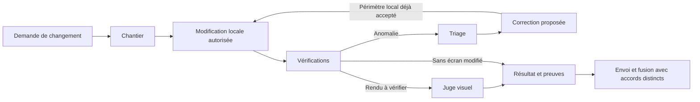

# Quel skill utiliser et quand

Routage du Portfolio, 6 novembre 2026. Les descriptions des skills et `CLAUDE.md` orientent
les agents ; ce document n’installe aucun hook ni processus en arrière-plan.

| Situation | Consigne à lire | Résultat attendu |
|---|---|---|
| Nouveau chantier accepté ou reprise | [chantier](../../.agents/skills/chantier/SKILL.md) | `spec.md` court ou intention/spec/plan, réalisation et preuves proportionnées |
| Bug signalé, contrôle inattendu en échec, livraison bloquée | [triage](../../.agents/skills/triage/SKILL.md) | Reproduction, diagnostic fondé sur les faits et proposition de correction |
| Écran modifié ou rendu à comparer | [juge-visuel](../../.agents/skills/juge-visuel/SKILL.md) | Observations sur la matrice complète, limites et commit testé |
| Composant externe reçu ou mis à jour | [procédure générale](reception-composants.md), puis chantier et juge visuel selon le besoin | Provenance, contrat, adaptations et vérifications dans la page réelle |
| Fin de session avec reprise prévue | [passation](../../.agents/skills/passation/SKILL.md) | Références et éléments non encore consignés, sans double source de vérité |
| Modification GSAP autorisée | `.claude/skills/gsap-doc/SKILL.md` puis références concernées | Respect des API et règles du projet ; aucun droit de modifier le mouvement Studio déduit |

## Enchaînements

Un bug signalé commence directement par triage. Un texte à changer sans anomalie ne déclenche
pas d’astreinte. Une hypothèse visuelle nécessite le parcours réel avant correction. Si un outil
ou une permission manque, le rapport le précise au lieu d’inventer une validation.
Une passation n’est utile qu’en fin de session ; ne pas la produire après chaque petite action.
Les skills métier et outils de Skyline ne sont pas tous importés : le Portfolio garde sa stack,
son contenu et sa frontière avec Cal.com et l’OS personnel.

## Pourquoi ce sous-ensemble Oncall

Seul `triage` et ses deux références adaptées sont ajoutés. La passation de session est déjà
couverte par Skyline. Les rapports périodiques `weather`, le déploiement d’une astreinte Slack
et `oncall-setup` exigent des sources de signaux, des connexions et un besoin qui ne sont pas
établis ici. Aucun incident fictif amont n’est repris comme un fait du Portfolio.
La [provenance](../../.agents/skills/triage/references/origine-oncall.md) conserve le commit,
les fichiers et la licence. Les permissions restent dans [autonomie.md](autonomie.md).
