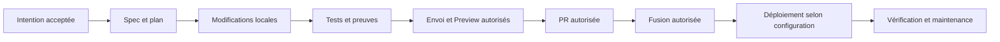

# Développer le Portfolio

Méthode reprise de Skyline Drive et adaptée aux autorisations d’Elias du 5 novembre 2026.
Le but est un résultat vérifiable, avec une trace suffisante pour reprendre entre sessions.
Les permissions sont définies séparément dans [autonomie.md](autonomie.md).

## Le circuit

Une autorisation ne couvre que les opérations qu’elle nomme. Si une fusion déclenche la
Production, le signaler avant de l’exécuter. Pas de publication automatique déduite du schéma.

## Choisir la taille du chantier

- **Circuit court** : texte, espacement ou correction isolée, sans changement du contrat,
  du mouvement validé, d’une dépendance ou du traitement de données. Une `fiche.md` suffit :
  pourquoi, résultat attendu, vérification. Une correction évidente d’une ligne peut se
  traiter directement selon la demande, sans créer artificiellement un chantier.
- **Circuit complet** : nouvelle fonctionnalité, intégration externe avec adaptations,
  changement transversal ou sensible. `intent.md` → `spec.md` → `plan.md`, puis code et preuves.
  La complexité, les risques et la réversibilité guident le choix ; le nombre de fichiers seul ne suffit pas.
- Si une décision importante manque, proposer les options et une recommandation à Elias.
  Ne pas demander une seconde fois une décision déjà acceptée dans la session.

L’agent prépare les documents et avance sur les étapes locales déjà autorisées. Il sollicite
Elias pour une décision nouvelle, un écart au périmètre ou une action exigeant un accord,
pas pour la simple exécution du plan accepté. Les modèles sont dans
[le skill chantier](../../.agents/skills/chantier/SKILL.md).

## Où va quoi

| Information | Emplacement |
|---|---|
| Pourquoi et résultat attendu | `specs/NNN-sujet/intent.md` |
| Comportements, scénarios et décisions | `specs/NNN-sujet/spec.md` |
| Fichiers réservés, ordre, risques et preuves attendues | `specs/NNN-sujet/plan.md` |
| Petite modification | `specs/NNN-sujet/fiche.md` |
| Recherche réellement effectuée | `research.md` du chantier, sources datées |
| Résultats, commit testé et limites | `verification.md` du chantier |
| Origine et adaptations d’un composant | fiche dans `docs/composants/` |
| Règle durable | `CLAUDE.md`, procédure ou skill concerné |
| Suivi d’avancement | issue et projet GitHub, lorsqu’ils existent et sont vérifiés |
| Reprise temporaire entre sessions | `.passations/`, hors commit |

NNN est le numéro de l’issue. Si sa création n’est pas autorisée, garder le brouillon local
hors du dépôt ou dans un dossier explicitement provisoire ; ne pas inventer de numéro.
Une seule PR par chantier dans un dépôt. Une livraison entre projets passe par deux historiques
et, si nécessaire, deux PR distinctes. Les dossiers de chantier sont figés à leur fusion ; une
évolution ultérieure ouvre un nouveau chantier. Les fiches courantes de composants, elles,
sont mises à jour lors d’une nouvelle réception en conservant leurs références précédentes.

## Suivi et reprise

Lire l’issue et ses commentaires, puis le dossier de chantier et le code. Les issues historiques
peuvent contenir des décisions : conserver leur lien tant qu’elles ne sont pas documentées.
Avant de toucher des fichiers, vérifier les travaux existants et les réservations du plan.
Ne pas réinitialiser un arbre pour se débarrasser d’un conflit ou d’un fichier personnel.

Statuts proposés comme Skyline : Idée, Cadrage, Prêt, En cours, À vérifier, Terminé, Abandonné.
Le projet Portfolio et ses champs doivent être inspectés avant utilisation : aucun identifiant
Skyline, automatisme de clôture ou protection de branche n’est transposable par supposition.
`TASKS.md` reste un renvoi ; sa reprise est détaillée dans [le relevé](../suivi/reprise-tasks.md).

Organisation demandée par Elias : Frontend, Backend, Socle et Automatisation. Le projet GitHub
n’a pas été configuré par cette discussion. Un axe principal classe le résultat ; les étiquettes
peuvent préciser les parties touchées. Les tests et le déploiement sont dans le Socle ; une
automatisation métier peut utiliser le backend. Le traitement propre à l’OS reste dans son projet.

## Vérifier et livrer

- Documentation seule : relire les décisions, vérifier les liens, les chemins et l’absence de
  contradictions. Si des commentaires de source changent, vérifier aussi que le code exécutable reste identique.
- Interface : tests disponibles, rendu et interactions selon [la matrice de réception](reception-composants.md#vérifier-dans-le-site-réel).
- Réservation et données : vérifier refus, erreurs et parcours réel avec les permissions requises.
  Une API simulée ne prouve pas un rendez-vous distant. Ne pas créer de vraie réservation sans accord.
- Ne pas ajouter un test qui ne vérifie que les mots d’un document ou reproduit l’implémentation.
  Ne pas affaiblir un contrôle pour le rendre vert.
- Distinguer contrôles locaux, contrôles GitHub, déploiement et validation d’Elias.
  Aucun résultat absent ne vaut réussite.

Chaque preuve mentionne commit, date, commande ou parcours, environnement, résultat et limites.
Un arbre modifié se décrit comme tel ; après changement du code, les preuves précédentes ne
valident pas le nouveau code. La PR présente le résultat pour un lecteur sans la conversation.
Ne clôturer l’issue qu’en fonction de ses critères et de l’autorisation reçue.

## Maintenance

Ouvrir [triage](../../.agents/skills/triage/SKILL.md) pour un bug signalé, un contrôle inattendu
en échec ou un problème de livraison. [Le routage](choisir-un-skill.md) distingue ce diagnostic
d’un chantier normal, d’une vérification visuelle et d’une passation de session.

Reproduire le problème, dater ce qui est observé, consulter les incidents similaires et formuler
une hypothèse avec ses preuves. Corriger dans le bon projet, rejouer le parcours qui échouait,
puis noter la cause confirmée, la correction et ce qui pourrait prévenir une répétition.
Une lecture inaccessible ou un contrôle non terminé se signale comme une limite.
Les corrections locales documentées n’autorisent ni retour arrière de production ni envoi externe.
La mise en place d’une CI, de captures autonomes ou d’une surveillance est un chantier séparé,
avec outillage et permissions explicites.
