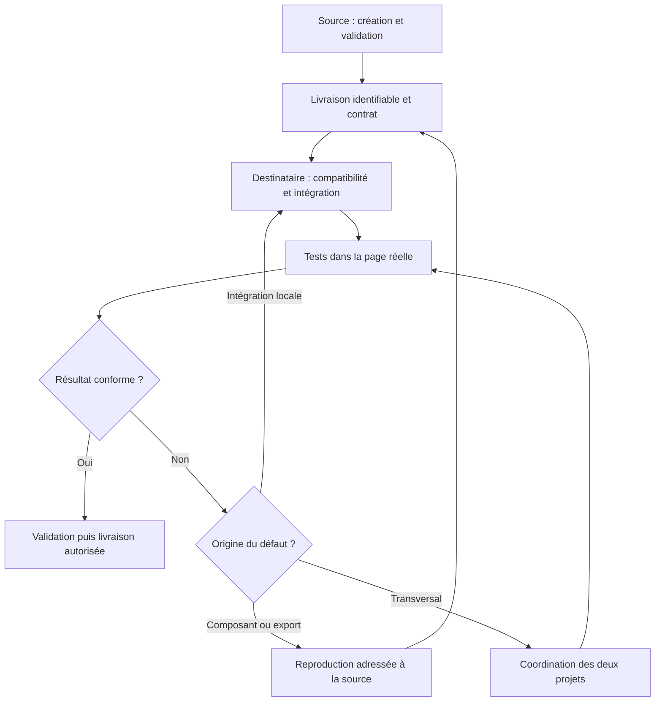

# Recevoir un composant externe

Cette procédure vaut pour une section, un composant d’interface, un visuel ou un module livré
par un autre projet ou fournisseur. Adapter le détail à son risque ; Video Animation n’est
qu’un [premier exemple](../composants/notes-chat.md). Aucun framework, outil de création ou
format d’export n’est imposé à toutes les sources.

## 1. Identifier la provenance

Noter fournisseur/projet, responsable ou contact connu, chemin, version et commit immuable
quand disponible. Distinguer le commit de comparaison du commit historique d’import : si
ce dernier n’a pas été enregistré, l’écrire. Lire les consignes du destinataire et comprendre
comment la source a construit et validé ce composant, sans reproduire tout son processus.
Séparer résultats observés, déclarations du fournisseur, hypothèses et informations inconnues.

Une fiche courte suffit pour un visuel simple. Une intégration interactive demande le contrat
plus complet ci-dessous. Utiliser [le modèle](../modeles/composant-externe.md).

## 2. Vérifier la livraison

- Inventaire des fichiers et assets réellement utilisés, empreintes si utiles, polices et droits
  d’utilisation ou licences. Un droit inconnu reste inconnu ; il n’est pas acquis par la copie.
- Versions exactes testées des dépendances, environnement et compatibilité avec le destinataire.
  Ne pas ajouter une seconde copie d’une bibliothèque sans nécessité validée.
- Instructions d’import et de démarrage, paramètres, état initial/final et arrêt/retrait complet.
  Noter les commandes réellement présentes ; une fonction interne ne devient pas une API publique.
- Dimensions, place disponible, adaptation responsive, variantes, orientations, thèmes,
  clavier et réduction des animations ; fallback lisible si la lecture ne s’exécute pas.
- Aperçu validé et son identité, limites connues, adaptations locales permises, changements
  exigeant un retour à la source, contact pour la correction et possibilité de revenir en arrière.

Si une information manque, évaluer son effet avant intégration. Une inconnue touchant le rendu
validé, les droits, la sécurité ou la compatibilité ne se comble pas par supposition : consigner
le manque et obtenir la clarification ou la livraison corrigée avant l’adaptation concernée.
Un ancien composant peut être documenté avec ces limites sans être déclaré prêt pour une nouvelle réception.

## 3. Intégrer sans dérive cachée

La source porte la logique et le rendu intrinsèques ; le destinataire porte placement,
navigation, contenu métier et interactions d’intégration dans les limites du contrat.
Ne pas déplacer une décision produit dans le composant reçu.

Conserver une version importée identifiable et noter les adaptations et leur raison. Examiner
les styles globaux, identifiants, dépendances, chargement et interférences avec la page. Tester
plusieurs instances si le contrat le prévoit ; ne pas annoncer cette capacité sans la vérifier.
Les commandes de lecture d’un composant ne décident pas de la relecture au scroll du site.
Chaque dépôt garde ses branches et ses PR ; aucun push, transfert ou déploiement automatique
entre projets n’est autorisé par cette procédure.

## Vérifier dans le site réel

Une validation isolée à la source ne valide pas la page destinataire. Utiliser les outils
réellement disponibles, noter les cas non exécutés et comparer au rendu de référence identifié.
La matrice s’applique aux changements d’interface ; un chantier documentaire n’en devient pas
une validation visuelle. Le détail des preuves est fourni par [le juge visuel](../../.agents/skills/juge-visuel/SKILL.md).

| Axe | Cas à couvrir |
|---|---|
| Téléphone | Petit écran et format courant, par exemple 360 × 800 et 390 × 844 |
| Tablette | Par exemple 768 × 1024, portrait et paysage pertinents |
| Ordinateur | Par exemple 1440 × 900 et fenêtre plus étroite |
| Tailles intermédiaires | Juste avant/après chaque seuil réellement utilisé par la page, plus une largeur entre formats |
| Redimensionnement | Passage entre formats sans rechargement ; changements d’orientation pertinents |
| Thèmes | Clair et sombre, y compris changement pendant la session |
| Mouvement | Réduction activée/désactivée, entrée/sortie et retour au scroll selon le contrat actuel |
| Parcours | Chargement, navigation, clics, clavier, focus, ouverture/fermeture et erreurs |
| Stabilité | Débordements, sauts de mise en page, ressources manquantes, console et fluidité |
| Cycle de vie | Sortie de route, retrait/remontage et absence de travail résiduel ou de doublons |

Couvrir les trois formats avec les deux thèmes et les deux préférences de mouvement. Croiser
les cas intermédiaires avec les variantes qui changent le rendu ; expliquer tout cas non exécuté.
L’émulation d’un iPhone reste une émulation, pas une mesure Safari/iOS réelle.
Pour le clavier et le retrait, utiliser un parcours qui exerce réellement ces comportements.
Aucune réservation réelle ni notification ne fait partie d’un test sans accord spécifique.

Une preuve conserve : date, commit source et destinataire, état propre/modifié de l’arbre,
URL/environnement, outil/navigateur, dimensions, thème, préférence de mouvement, scénario,
résultat observé et limites. Après modification, refaire les preuves concernées. Des captures
anciennes ou un build vert ne prouvent pas le rendu du nouveau commit.
Mesurer les performances à partir d’une référence dans le site réel ; ne pas déclarer des
budgets respectés ou un nettoyage correct sur la seule lecture du code.

## 4. Corriger et mettre à jour

- Défaut intrinsèque, asset ou export : reproduction et preuves pour la source ; nouvelle livraison.
- Défaut local de placement, navigation ou intégration : correction dans le destinataire.
- Défaut transversal : accord sur la répartition, tests des deux côtés et validation finale dans le site.

Une mise à jour indique la version précédente, les changements incompatibles et les adaptations
à reprendre. Tester avant adoption et conserver le retour possible à la version précédente.
Les droits d’écriture restent ceux de chaque projet : préparer un relevé ne permet pas de le publier.
