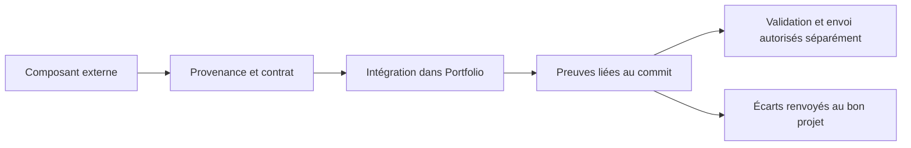

# Spec : réception générale et consignes Portfolio

Date : 2026-11-05 · Issue #5 · Périmètre et précisions acceptés par Elias en session.
Intention : [intent.md](intent.md). Statut de livraison : à relire après vérification locale.

## Résultat

1. Une procédure réutilisable quelle que soit la source : provenance, compatibilité, livraison,
   adaptations, vérification dans le vrai site, maintenance et responsabilité.
2. Une fiche minimale par composant, proportionnée à sa complexité, avec inconnues explicites.
3. Notes → Chat documente l’existant après comparaison des assets, courbes, repères et déclenchements.
   Aucun simple renommage v2/v3, ni changement de la relecture au scroll.
4. Consignes Portfolio corrigées ; écarts Studio dans un relevé séparé, sans action dans l’autre dépôt.
5. Une matrice comprenant téléphone, tablette, ordinateur, tailles intermédiaires, thèmes,
   réduction des animations, orientations et redimensionnement pertinents. Preuves liées au commit testé.
6. Structure Skyline adaptée : chantier complet ou fiche courte ; permissions indépendantes de la méthode.
   TASKS archivé sans perte des anciens sujets ; aucune CI déclarée active ou installée ici.

## Scénarios

- Un composant vient d’un autre fournisseur : le lecteur peut identifier ce qu’il reçoit,
  ce qui a été validé et ce qu’il doit vérifier, sans adopter le workflow de Video Animation.
- Une animation diffère dans la page : le lecteur sait distinguer défaut source, adaptation
  locale et inconnue, et sait vers quel projet adresser la reproduction.
- Une source mentionne une autre version : le relevé dit quels fichiers ont été comparés,
  les différences observées et ce qui ne permet pas d’établir la provenance historique.
- Une vérification manque : le rapport la laisse « non exécutée » ; il ne présente pas une
  compilation, une capture ancienne ou une émulation comme un test réel du nouveau commit.
- Un agent reprend le chantier : il retrouve les décisions, les fichiers réservés, les preuves
  et les limites, et ne publie ni ne fusionne en interprétant l’accord sur l’organisation.

## Hors périmètre

Mouvements, relecture au scroll, nouvelles sections, export standardisé, changement de stack,
configuration de CI, nouveau projet GitHub, suppression de branches et opérations externes.
