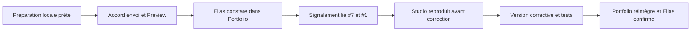

# Préparation de l’exercice, 6 novembre 2026

## État vérifié

- Branche Portfolio `essai/portfolio-7-circuit-bug`, base `dc37918d6e72e2aba918841f7c1af97e1357d5f8`.
- Branche Studio `essai/studio-1-circuit-bug`, commit d’export
  `60c3eda3b956374cd89d479ec5c9fec66938cd1d`, arbre propre.
- Version importée : `2.0.0-exercice.theme.1`, identifiant
  `portfolio-section01-web-exercice-theme`. Onze fichiers reçus contrôlés octet par octet.
  Déclaration TypeScript locale conservée. Détail : integrite.json.
- Défaut préparé : quatre sélecteurs CSS de palette erronés. La carte doit rester claire
  en sombre ; cette prévision n’est pas un constat utilisateur.
- JavaScript, courbes, HTML/SVG, assets et versions v2 conservés à l’identique.
- Aucun changement dans les dépôts de travail originaux ni les workflows vidéo/After Effects.

## Contrôles locaux

Exécutés sur le code d’essai modifié avant son premier commit Portfolio, avec les dépendances
déjà installées du Portfolio (lien node_modules, aucune installation). Date UTC, versions
Node/npm et sorties complètes : controles.json et les quatre fichiers .txt de ce dossier (lignes vides finales retirées).

37 tests réussis ; typage et build réussis. Lint : aucune erreur, quatre avertissements
Fast Refresh déjà signalés dans la réception v2. Build : avertissements lottie-web et taille
de chunks. Aucun de ces contrôles ne vérifie l’apparition du défaut dans le navigateur.
Seuls les documents et traces de contrôle sont ajoutés après ces commandes ; le code
exécutable du commit préparé est celui des contrôles.

## Parcours visuel à effectuer par Elias

Après autorisation d’envoi de la branche Portfolio, relever le commit réellement déployé,
l’URL Preview et son état. Charger en clair, descendre à la carte, attendre l’entrée,
puis passer en sombre. Relever appareil/navigateur, dimensions, préférence de mouvement,
attendu, observé et une preuve si disponible. Aucun navigateur piloté par l’agent.

Aucune Preview publiée à ce stade, aucune URL de test nouvelle, aucune reproduction
Portfolio ou Studio observée, aucun commentaire externe envoyé. Les deux tickets ont été
relus via le connecteur GitHub ; #1 est ouvert (mise à jour 12:03:14Z), #7 est ouvert,
sans commentaire au contrôle. Les liens réciproques sont déjà présents dans leurs corps.

Le signalement sera rédigé après le constat d’Elias et proposé pour publication dans #7
et #1. Ne pas envoyer un rapport fictif ou une confirmation anticipée.
Studio doit reproduire AVANT correction : préparer le second export seulement après
ce constat, puis conserver ses preuves et le nouvel identifiant immuable.

## Conclusion actuelle

Exercice préparé, chaîne non exécutée. #1 ne peut pas encore être clôturé.
Fluidité, chargement, nettoyage mesuré, thèmes, réduction des animations, formats et
navigation restent à vérifier séparément selon spec.md. La validation générale de la
Preview v2 reste acquise dans son périmètre historique.

## Constat utilisateur reçu après publication de la branche d’essai

Le push de `1ca19afc86d785843d00211987739c6e7a4852f1` a été autorisé puis effectué.
Preview : https://porfolio-elias-exkluevgt-eliassyllas-projects.vercel.app
Déploiement GitHub 7600007588, environnement Preview, état success vérifié via API.
Elias confirme le 6 novembre 2026 : « La carte est claire, donc le défaut est visible. »
Voir signalement.md pour le relevé, ses limites et les deux liens de suivi.
Les sections précédentes décrivent l’état historique à la préparation. État actuel :
constat Portfolio acquis ; reproduction Studio et correction non réalisées ;
publication du signalement en attente d’autorisation. Le code de la Preview est inchangé.

## Réception du correctif publié theme.2

Source : export 2c8bfb64f36a3a0ab37f19a97a70fbbdcb7689f7, preuves Studio
7cf665dd1a1845908e86a63c35051552530e8e83. Dernier commentaire fournisseur lu :
https://github.com/Eliassylla/porfolio-elias/issues/7#issuecomment-6685492734
Son accusé Studio est https://github.com/Eliassylla/video-animation/issues/1#issuecomment-6685490019.

Récupération depuis GitHub ; quatorze empreintes source vérifiées, onze fichiers
importés identiques, déclaration TypeScript locale conservée. Aucun vendor chargé
dans le site. Les imports de TextGlowSection sélectionnent exclusivement essai-theme-002.
Les versions v2 et essai-theme-001 restent conservées, sans modification.
Détail : reception-publiee-theme2.json.

Les nouveaux contrôles Portfolio sont dans controles-reception-theme2.json et les
quatre sorties reception-*.txt. Aucune nouvelle dépendance ; environnement installé
du Portfolio réutilisé. Le code contrôlé est celui du commit de réception qui contient
ce relevé ; les documents seuls pourront être complétés après le constat utilisateur.

Le rendu dans la vraie page Portfolio reste à confirmer par Elias, selon son choix
de ne pas utiliser de navigateur piloté par l’agent. Un build local peut être servi
pour ce constat sans publication externe. Aucun résultat Studio n’est compté comme
un essai Portfolio. Aucun push correctif, nouveau déploiement ou commentaire de
réception n’a été autorisé dans cette reprise. Aucun ticket à clôturer.

## Confirmation utilisateur du correctif dans Portfolio

Le 6 novembre 2026, Elias confirme un résultat positif après le scénario demandé
clair → sombre → clair sur http://127.0.0.1:4177/. Le code testé est celui de
7867c5abe3fb1b951a675cf232d7d408d6168e75 ; la documentation postérieure ne le modifie pas.
Version : 2.0.0-exercice.theme.2, source 2c8bfb64f36a3a0ab37f19a97a70fbbdcb7689f7.
Le défaut contrôlé est résolu pour ce parcours. Aucun navigateur piloté par l’agent,
aucune capture Portfolio fournie ; appareil, dimensions et préférence de mouvement inconnus.
Aucune validation de fluidité, chargement ou nettoyage mesuré n’est déduite de ce retour.
Confirmation préparée pour #1 avec lien #7 ; publication des preuves et des commentaires
en attente d’autorisation. Aucun push correctif ou commentaire supplémentaire exécuté.
