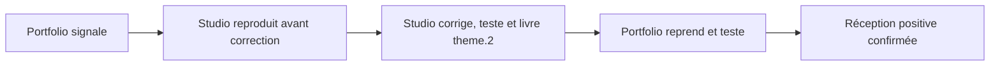

# Bilan de réception du pilote et du circuit entre projets

Préparé le 6 novembre 2026 pour Portfolio #7 et Video Animation #1.

## Résultat attendu et périmètre accepté

Elias voulait vérifier que Portfolio peut signaler un défaut au Studio, que celui-ci le
reproduit avant correction et livre une version identifiable, puis que Portfolio la reprend
et confirme le résultat. Le but était aussi de clarifier les responsabilités entre projets.
L'exercice est réussi et les contrôles ciblés de la v2 hébergée sont consignés ci-dessous.

Après explication des limites, Elias accepte de conclure ce pilote sans poursuivre les
mesures approfondies de mémoire/nettoyage et la comparaison avant/après. Le Portfolio
est encore en conception ; les prochaines sections feront l'objet de travaux distincts.
Ces contrôles sont reportés à l'assemblage des vraies sections et à la préparation de la
production, ou plus tôt si un ralentissement apparaît. Ils ne sont pas déclarés réussis.

## Livraison saine du site

- Source : `portfolio-section01-web-v2 / 2.0.0-prototype`, commit
  `2f347a9059b4658f4b68fde0cbb353ad4113f582`, PR Studio #4 déjà fusionnée.
- Intégration Portfolio : commit `dc37918d6e72e2aba918841f7c1af97e1357d5f8`, PR #8
  déjà fusionnée à `4f23eeec9cd5e7f0794bdb48fbee7140a68e68dc`.
- Preview testée : https://porfolio-elias-qsoiwgij5-eliassyllas-projects.vercel.app/
- La comparaison GitHub entre le commit de Preview et le main contrôlé ne présente
  aucun fichier différent. Identité détaillée dans archives/preview-v2/identite.json.
- La branche d'exercice et theme.2 ne sont pas une nouvelle livraison du site en production.
  Cette PR ne modifie aucun fichier applicatif et ne fusionne pas l'exercice dans main.

## Circuit exécuté

| Étape | Référence et preuve |
|---|---|
| Défaut contrôlé Studio | theme.1, `60c3eda3b956374cd89d479ec5c9fec66938cd1d` |
| Signalement et reproduction avant correction | [Portfolio](https://github.com/Eliassylla/porfolio-elias/issues/7#issuecomment-6685035707), [Studio](https://github.com/Eliassylla/video-animation/issues/1#issuecomment-6685038579) |
| Correctif Studio | theme.2, `2c8bfb64f36a3a0ab37f19a97a70fbbdcb7689f7` |
| Livraison et tests Studio | [Publication](https://github.com/Eliassylla/video-animation/issues/1#issuecomment-6685490019), preuves `7cf665dd1a1845908e86a63c35051552530e8e83` |
| Réintégration testée | Portfolio `7867c5abe3fb1b951a675cf232d7d408d6168e75`, build local, résultat positif d'Elias |
| Confirmation réciproque publiée | [Studio](https://github.com/Eliassylla/video-animation/issues/1#issuecomment-6685996249), [Portfolio](https://github.com/Eliassylla/porfolio-elias/issues/7#issuecomment-6685999138) |
| Archives de l'exercice déjà publiées | Branche `essai/portfolio-7-circuit-bug`, commit `28fab0ea44abe14ef4c10387cd262b8b965ddae9` |

Le Studio possède le mouvement, les assets et l'export. Portfolio possède le placement,
le contenu métier, les parcours et la réception dans sa vraie page. Les versions et les
preuves font la passation ; il n'existe aucune adoption ou clôture automatique entre projets.

## Contrôles de réception effectués

Les 37 tests du dépôt, le typage et la compilation ont réussi, avec quatre avertissements
lint connus et aucune erreur. La source reçue est contrôlée par empreintes. La validation
visuelle initiale d'Elias en Preview est conservée dans les retours liés de #1 et #7.

La reprise navigateur sur la v2 saine couvre douze variantes : trois formats émulés,
clair/sombre et mouvement normal/réduit, avec changements de thème et aller-retour au
scroll. Dimensions CSS réellement observées : 433×938, 853×1138 et 1600×1000.
Chrome 156/macOS, aucun appareil réel. Contenu lisible, palette et format cohérents,
aucun débordement horizontal relevé. Les captures et données brutes sont dans
[les preuves hébergées](archives/preview-v2/verification.md).

Ouverture/fermeture de la réservation sans soumission ; navigation 404/accueil puis
arrière/avant de l'historique : zéro section sur 404, une seule au retour. La nouvelle
entrée se termine avec un contenu visible. Aucune erreur/alerte dans la collecte console
finale. Aucun vrai rendez-vous, email ou notification créé.

Le relevé de chargement conservé et six échantillons RAF de deux secondes sont limités
et décrits dans le rapport brut. Ils ne prouvent ni un gain avant/après, ni un budget
respecté, ni une performance de téléphone réel. Les données terrain p75 ne sont pas
établies. Le score Speed Insights rapporté par Elias n'est pas transformé en comparaison
historique. Web Analytics #10 et les checks automatiques #9 restent des chantiers distincts.

## Contrôles reportés explicitement

- Nettoyage mesuré complet des mécanismes d'animation et de la mémoire sur des cycles répétés.
- Comparaison fiable de chargement et performances avant/après, et mesures sur appareils réels.
- Matrice exhaustive des seuils, orientations, clavier et autres navigateurs non exécutés.

Ces points ne remettent pas en cause le circuit démontré. Ils seront définis selon les
vraies sections et leurs risques, sans prétendre que tout le Portfolio est prêt pour la
production. Les mouvements validés, la vidéo et After Effects sont préservés.

## Conservation et clôture

Les dossiers archives/exercice et archives/preview-v2 sont des copies documentaires des
preuves, sans import des exports d'essai ni du changement d'adaptateur dans main. Leurs
rapports datés conservent les anciens états de préparation et chemins du checkout d'essai ;
ce présent bilan prévaut pour le périmètre de clôture accepté. Les références immuables
permettent de retrouver les exports à la source. Inventaire : archives/inventaire.json.

Après PR documentaire contrôlée et fusion autorisée, publier le bilan réciproque puis
fermer #7 et #1 avec l'accord correspondant. L'acceptation du périmètre ne vaut pas
publication ou clôture déjà effectuée. Ne pas ajouter de fermeture automatique de #1.
Ne supprimer aucune branche ou copie temporaire avant vérification des archives et accord.
